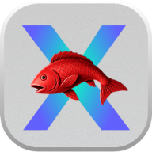
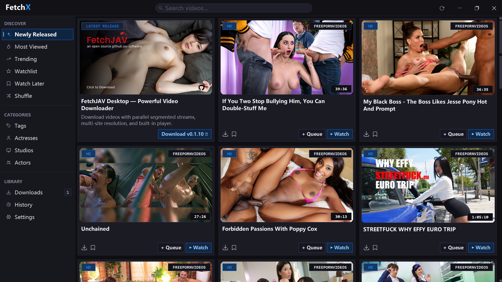
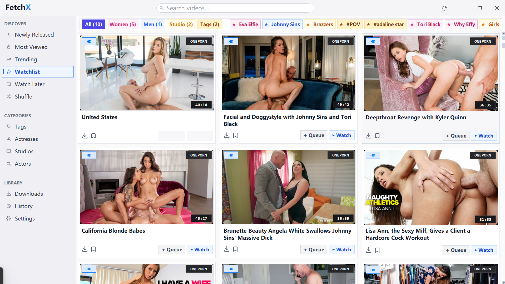
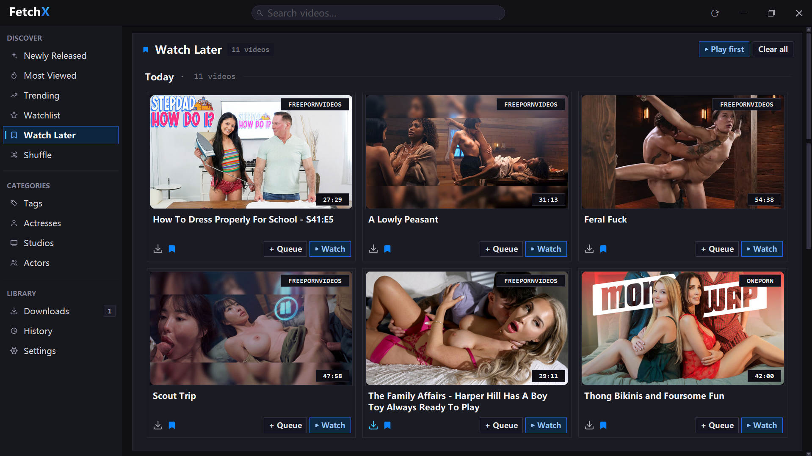
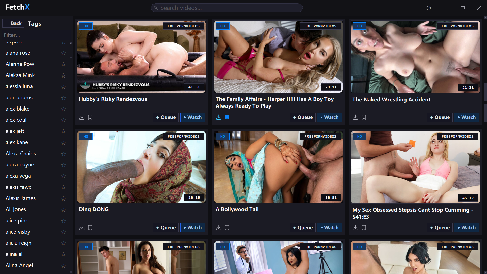
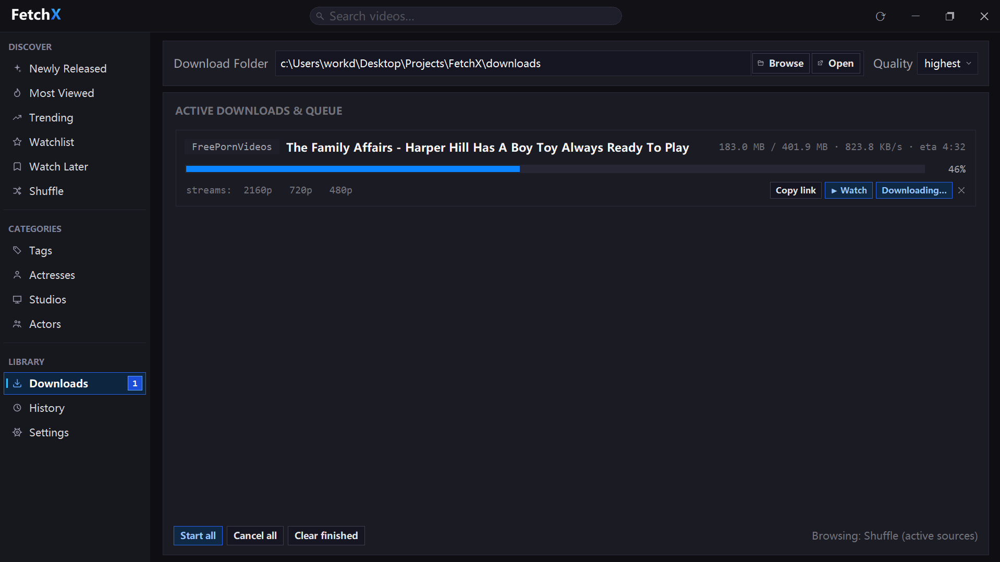
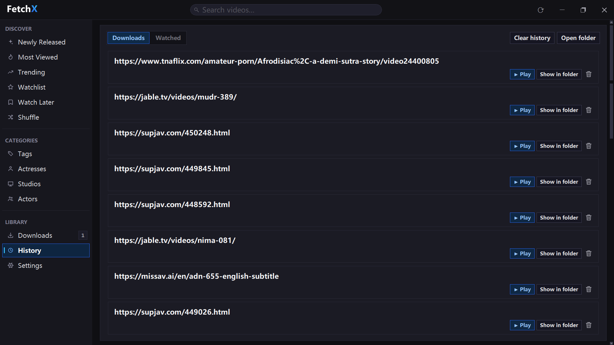
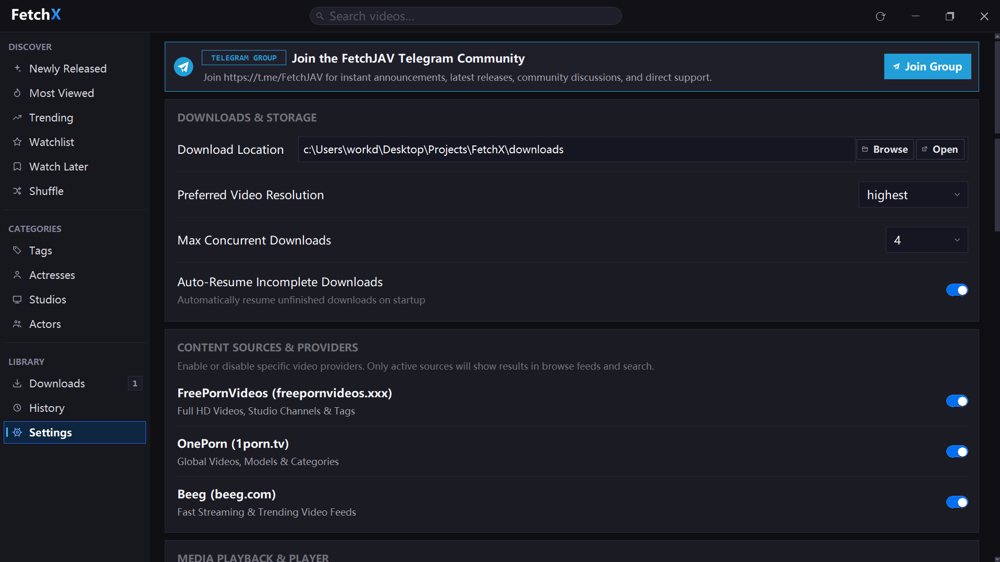

# FetchX

<div align="center">



### High-Performance Desktop Media Browser, HLS Downloader & VLC Theater
*Developed as part of the **FetchJAV Project**, powered by the proven FetchJAV fetcher core.*

[](https://www.python.org/)
[](https://docs.python.org/3/library/tkinter.html)
[](https://www.videolan.org/vlc/)
[](#features)
[](https://t.me/FetchJAV)

</div>

---

## 📌 Overview

**FetchX** is a feature-rich, standalone Windows desktop application and self-hosted media engine designed for effortless browsing, instant preview streaming, and multi-connection HLS downloading across supported video providers.

Built with a custom **Liquid-Glass** design system, FetchX provides dark and light themes, an adaptive 3-column video grid, taxonomy drill-downs (Actresses, Studios, Tags, Actors), dynamic Watchlists, Watch Later bookmarks, and a fully embedded **libVLC media player** with theater and true fullscreen modes.

> 🔒 **Personal, self-hosted use:** Runs entirely on your local machine. All downloads land in your specified folder and no personal data is shared publicly.

---

## 📸 Screenshots & Feature Walkthrough

### 1. Browse Grid & Media Discovery
Explore newly released, trending, and most-viewed videos across all enabled content providers in a responsive, modern grid with thumbnail overlays, duration badges, and instant action buttons.

<div align="center">
  
</div>

- **Liquid Glass UI:** Dark-themed responsive grid that dynamically scales from 1 to 4 columns based on window size.
- **Card Overlays:** High-definition (`HD`) badges, source site tags (`FreePornVideos`, `OnePorn`, `Beeg`), and video length pills.
- **Quick Actions:** Single-click buttons to add to Download Queue (`+ Queue`), play in built-in VLC player (`▶ Watch`), download directly, or bookmark to Watch Later.
- **Dynamic Notices:** Integrated announcement cards with update notes and direct download links.

---

### 2. Watchlist & Starred Releases
Stay up to date with new releases from your favourite actresses, actors, studios, and categories with the dynamic liquid-glass filter bar.

<div align="center">
  
</div>

- **Liquid Glass Filter Bar:** Top capsule bar with category pills (`All`, `Women`, `Men`, `Studio`, `Tags`) showing live item counts.
- **Interactive Outline Glass Chips:** Horizontally scrollable chip rail with color-coded outline glass styling for starred entities (e.g. `★ Eva Elfie`, `★ Johnny Sins`, `★ Brazzers`, `★ #POV`).
- **Smooth Navigation:** Supports horizontal mousewheel scrolling and click-and-drag panning.
- **Auto-Aggregated Feed:** Automatically resolves and merges latest releases from all starred items across all enabled sources.

---

### 3. Watch Later & Bookmarks
Organize videos you want to watch later into clean, date-grouped collections with instant one-click playback.

<div align="center">
  
</div>

- **Date Grouping:** Automatically categorizes saved videos into chronological sections (e.g. `Today · 11 videos`).
- **Interactive Top Filter Bar:** Filter bookmarked videos by specific provider site or save date.
- **Queue & Play:** Start sequential playback with `▶ Play first` or clear bookmarked items with `Clear all`.

---

### 4. Sidebar Taxonomy & Category Drill-Down
Quickly drill down into thousands of actresses, studios, actors, and tags with instant fuzzy search filtering.

<div align="center">
  
</div>

- **Four Deep Taxonomies:** Browse across **Tags**, **Actresses**, **Studios / Channels**, and **Actors**.
- **Instant Search Filter:** Real-time filter input (`Filter...`) with fuzzy matching across thousands of entries.
- **One-Click Star:** Toggle Watchlist status (`★` / `☆`) directly from the sidebar item row with glowing active indicators.

---

### 5. Multi-Threaded HLS Downloads Queue
High-performance download manager with mirror failover, AES-128 segment decryption, ffmpeg remuxing, and real-time bandwidth metrics.

<div align="center">
  
</div>

- **Real-Time Bandwidth Stats:** Live display of downloaded bytes, total size, transfer speed (`KB/s` / `MB/s`), and dynamic ETA countdown.
- **Multi-Stream Resolution:** Detects available stream resolutions (`2160p 4K`, `1080p`, `720p`, `480p`).
- **Queue Controls:** Play while downloading (`▶ Watch`), copy source link (`Copy link`), cancel (`✕`), and batch actions (`Start all`, `Cancel all`, `Clear finished`).
- **Sidebar Badge:** Live badge counter indicating active in-progress downloads.

---

### 6. Playback & Download History
Keep track of previously downloaded and watched videos with direct filesystem integration.

<div align="center">
  
</div>

- **Dual-View Logging:** Separate subtabs for `Downloads` and `Watched` video logs.
- **Filesystem Actions:** Open downloaded file directly in default media player (`▶ Play`), reveal in Windows Explorer (`Show in folder`), or remove individual history records.

---

### 7. Settings, Provider Toggles & Telegram Community
Configure storage directories, stream resolution preferences, concurrency limits, and active video providers.

<div align="center">
  
</div>

- **Telegram Community Banner:** Permanent quick-access banner to the official [FetchJAV Telegram Group](https://t.me/FetchJAV) for updates, releases, and support.
- **Storage & Quality Preferences:** Customizable download directory, preferred video quality (`highest`, `1080p`, `720p`), max concurrent downloads, and auto-resume on startup.
- **Provider Toggles:** Enable or disable specific video sources (FreePornVideos, OnePorn, Beeg, JableTV, MissAV, SupJav, etc.) to tailor search results and browse feeds.

---

## ⚡ Quick Start

### Prerequisites
- **Python 3.10+** (64-bit recommended)
- **VLC Media Player** (optional, recommended for embedded playback)
- **FFmpeg** (optional, for stream remuxing)

### Installation

```bash
# Clone the repository
git clone https://github.com/DeepanshuK2002/FetchX.git
cd FetchX

# Install required Python dependencies
pip install -r requirements.txt

# Launch the desktop application
python FetchX_Desktop.py
```

---

## 📦 Building Windows Executable (.exe)

You can package FetchX into a standalone Windows executable using PyInstaller:

```bash
# Install PyInstaller
pip install pyinstaller

# Build using the provided spec file
pyinstaller FetchX.spec --noconfirm

# Output binary will be generated at:
# dist/FetchX.exe
```

Or simply run the build batch file:
```cmd
build_desktop_exe.bat
```

---

## 🌐 Self-Hosted Web UI (Alternative Mode)

FetchX also includes a lightweight FastAPI backend with a zero-dependency web frontend:

```bash
python run_server.py
# Access web UI at: http://127.0.0.1:8619
```

### Environment Variables

| Variable | Default | Description |
|---|---|---|
| `FETCHX_HOST` | `127.0.0.1` | Bind address (`0.0.0.0` for local network access) |
| `FETCHX_PORT` | `8619` | Server HTTP port |
| `FETCHX_DOWNLOAD_DIR` | `./downloads` | Directory where completed downloads are saved |
| `FETCHX_CONCURRENCY` | `2` | Number of simultaneous download workers |
| `RESOLUTION` | `highest` | Default stream resolution (`highest`, `1080p`, `720p`, etc.) |

---

## 📁 Project Architecture

```
FetchX/
├── FetchX_Desktop.py         # Main Tkinter desktop application (UI, Player, Queue)
├── config.py                 # User configuration, preferences, watchlist, cache
├── site_i18n.py              # Internationalization & site translation helpers
├── video_identity.py         # Metadata, actor/tag taxonomy normalization
├── updater.py                # In-app background update checker
├── analytics.py              # Local metrics and session state
├── run_server.py             # FastAPI web server entry point
├── M3U8Sites/                # Site extractors, HLS engine, AES decryptor, ffmpeg remuxer
├── fetchx/                   # Server REST layer & job queue registry
│   └── web/                  # Self-hosted single-file web client
├── assets/                   # App icons, fonts, brand logos, announcement assets
├── docs/                     # Documentation and screenshots
│   └── screenshots/          # Application screenshot assets
├── requirements.txt          # Python dependencies
└── FetchX.spec               # PyInstaller build specification
```

---

## 💬 Community & Support

Join the official Telegram group for announcements, feature discussions, and direct support:

[](https://t.me/FetchJAV)

---

## 📄 License & Disclaimer

FetchX is provided for **personal, educational, and self-hosted use only**. Users are responsible for complying with local regulations and the terms of service of all accessed websites.
