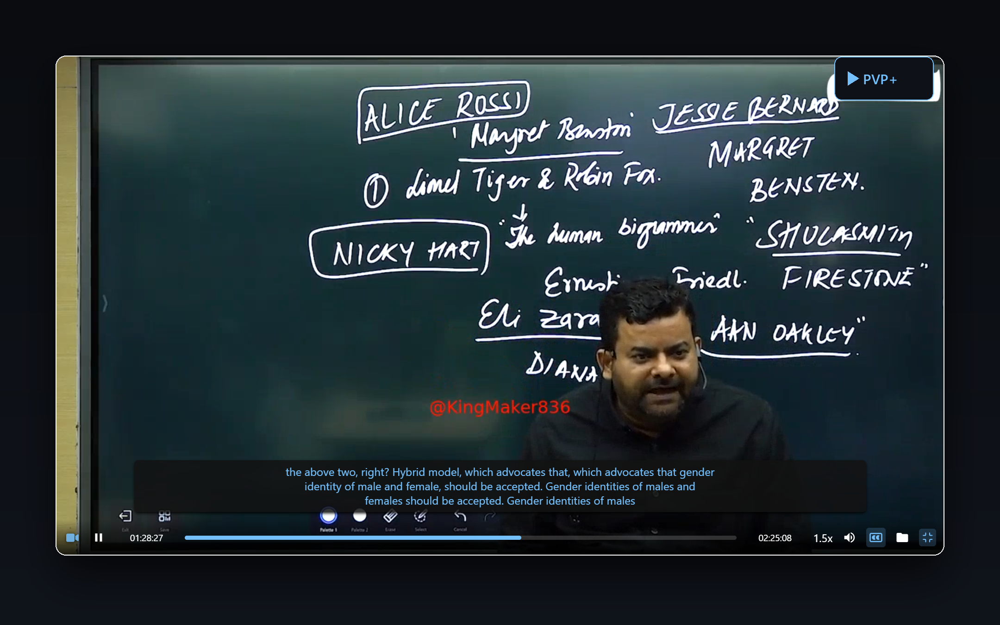
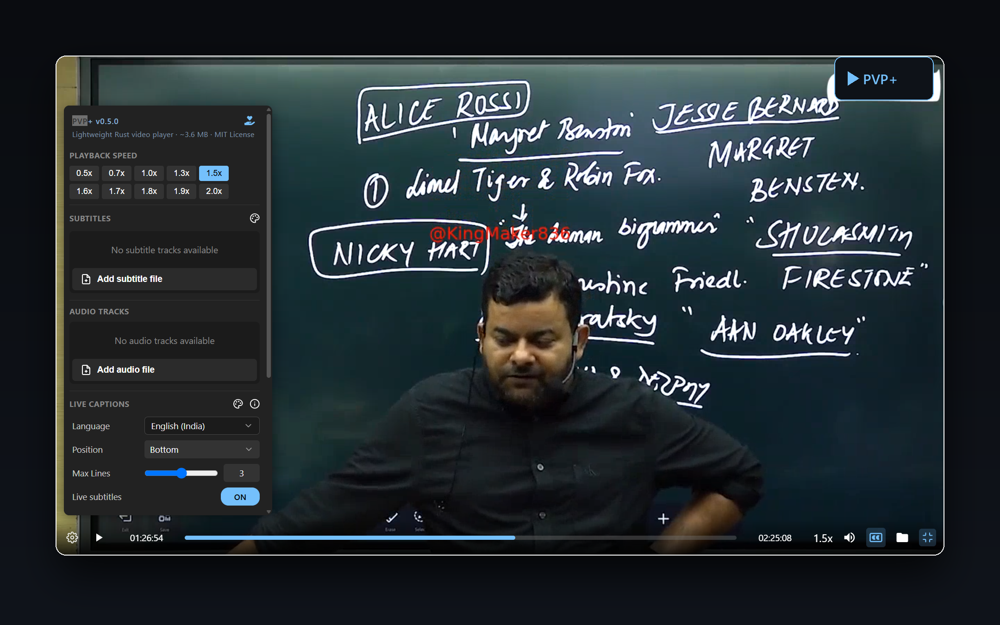
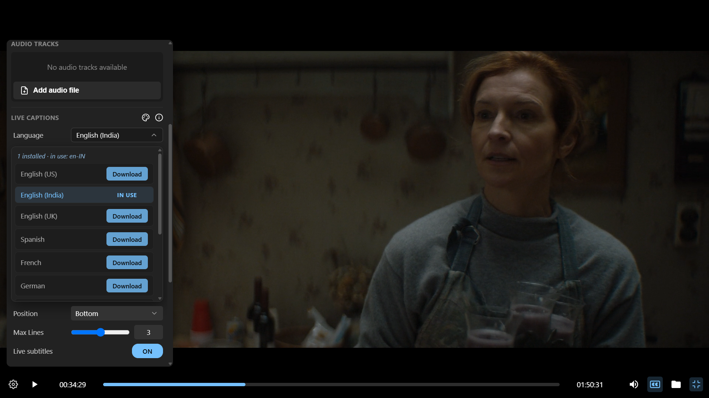
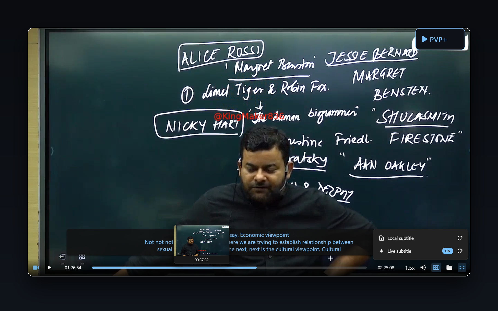
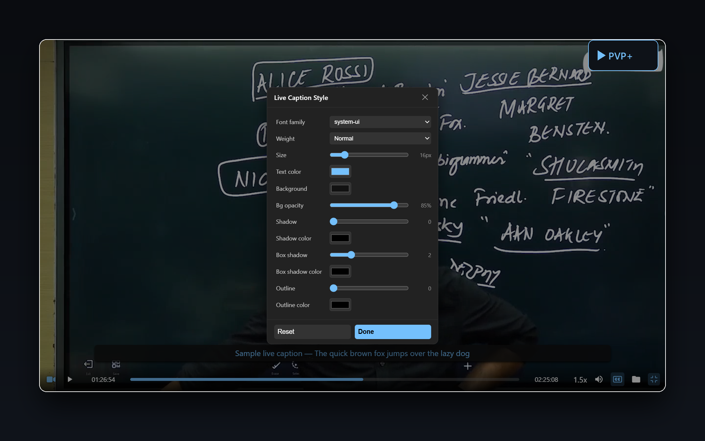
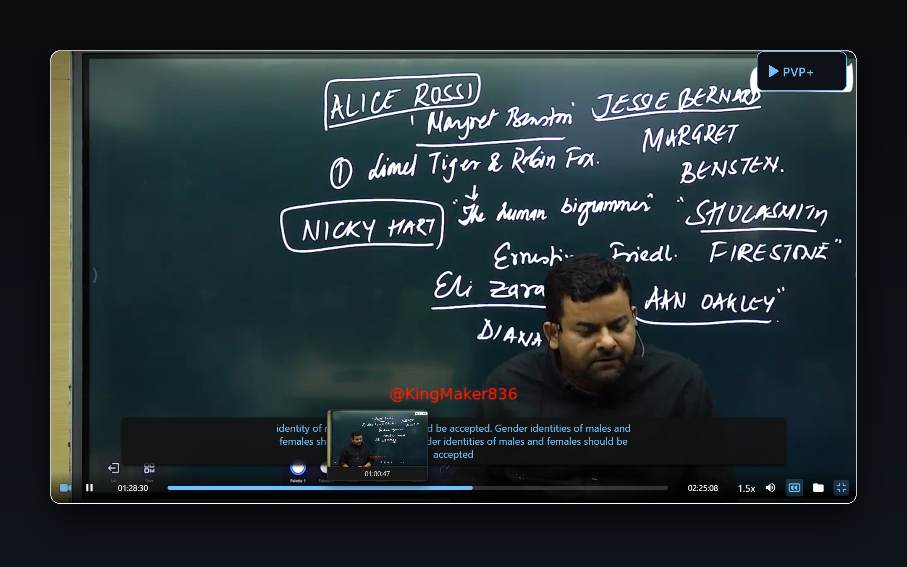
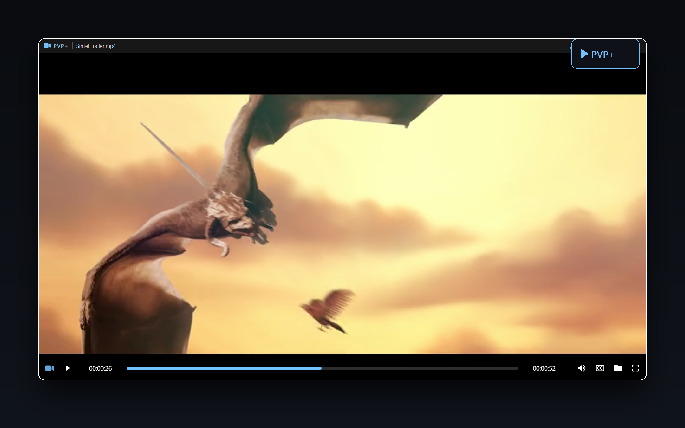
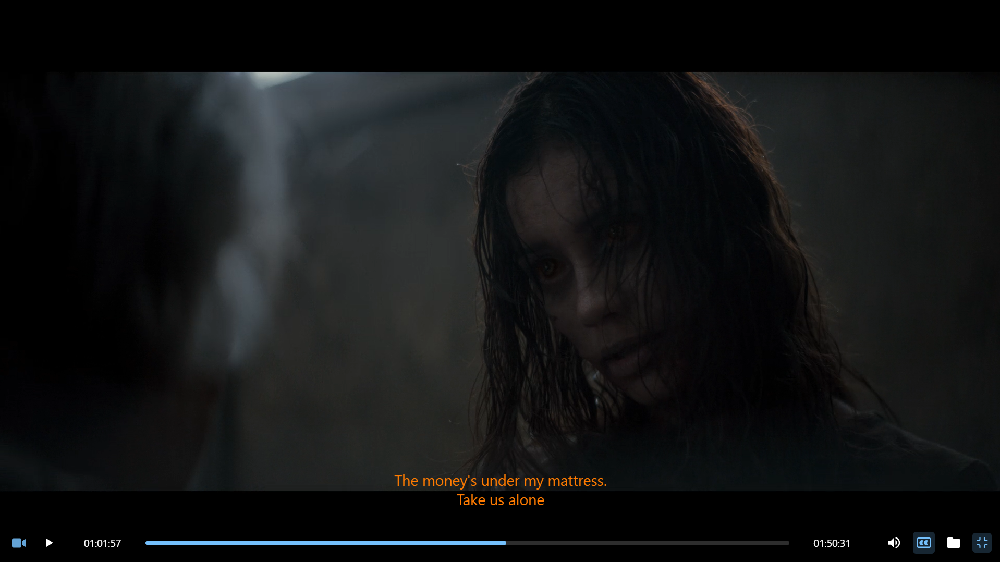

<div align="center">


# Personal Video Player — PVP+

**The 3.8 MB video player with live captions.**

A single Rust binary. No Electron. No Chromium bundle. No installer wizard,
no telemetry, no account, no ads — just press play.

[](https://github.com/DeepanshuK2002/Personal-Video-Player---PVP/releases)
[](https://github.com/DeepanshuK2002/Personal-Video-Player---PVP/releases)
[](https://github.com/DeepanshuK2002/Personal-Video-Player---PVP/releases)
[](https://www.rust-lang.org/)
[](https://www.microsoft.com/windows)
[](LICENSE)

**[Download v0.6.1](https://github.com/DeepanshuK2002/Personal-Video-Player---PVP/releases/latest)** · **[Website](https://deepanshuk2002.github.io/Personal-Video-Player---PVP/)** · **[Live Captions Guide](docs/live-captions.md)** · **[Screenshots](#screenshots)**

</div>

---

<div align="center">

### The whole player is smaller than a single subtitle font.

</div>

| | **PVP+** | VLC | mpv / MPC | Electron players |
|---|---|---|---|---|
| **Download size** | **3.8 MB** | 40 – 60 MB | 20 – 100 MB | 80 – 200+ MB |
| **Engine** | Rust + system WebView2 | Native + bundled Qt | Native | Bundled Chromium |
| **Install step** | None — one file | Full installer | Varies | Full installer |
| **Background services** | 0 | 0 | 0 | Often several |
| **Live captions** | **Built in** | — | — | — |
| **Startup** | Instant | Fast | Fast | Slow |

> One file, **3,994,624 bytes**. Copy it anywhere, run it, done. The entire UI —
> HTML, CSS, JS, icons and all — is compiled *into* the binary. Nothing to install,
> nothing to configure, nothing left behind.

---

## Live Captions — real-time speech-to-text, built in

The headline feature. Turn captions **on** and the words spoken in your video
appear over the video **as they are said** — no subtitle file, no download, no
transcription service, no internet.

<div align="center">
  
</div>

- **Powered by Windows Live Captions** — the recognizer ships with Windows 11,
  so PVP+ reuses it through the UI Automation tree instead of bundling a model.
- **11 languages** — English (US / India / UK), Hindi, Spanish, French, German,
  Italian, Japanese, Korean, Chinese (Simplified), with IN USE / Download states.
- **Never starts by itself** — captions only run when you toggle them.
- **Fully stylable** — its own style editor: font, size, colours, background,
  text shadow, box shadow (0 disables), outline stroke.
- **Position & density** — Bottom / Top / Center / 60% Center, plus a max-lines
  cap with clean whole-line clipping (no half-cut rows).
- **Always on top** — captions and hover previews render above the subtitle track.

```text
Windows Live Captions ──UIA tree──▶ Rust poll thread ──IPC──▶ player overlay
```

Requires Windows 11 22H2+ and volume above 5%. Full details, troubleshooting and
the per-language download notes live in **[docs/live-captions.md](docs/live-captions.md)**.

Toggle it any time with `C`, from the CC menu, or Settings → Live Captions.

---

## Features

<table>
<tr><td width="50%">

**Playback**
- Folder playlists with sort by time / name / duration (asc & desc)
- Playback speed `0.5x` → `2x`
- Volume boost up to `200%`
- Click-to-seek progress bar with current / total time
- Timeline hover preview (thumbnail + timestamp) that stays above captions
- Native fullscreen, auto-hiding controls
- Formats: MP4, MKV, AVI, MOV, WebM, OGG, WMV, M4V … (system codecs)
- Plays MPEG-TS / `.ts` / DVR rips too — remuxed on the fly via ffmpeg

</td><td width="50%">

**Interface & input**
- Modern minimal UI with a custom titlebar and PVP+ branding
- Drag & drop videos, whole folders, or `.srt` / `.vtt` files
- Subtitle style editor (font, size, colour, background, shadow, outline)
- CC menu: live-caption + subtitle rows, ON/OFF state, palette shortcut to styles
- File association — open videos from Explorer or the command line
- stdin support: `cat video.mp4 | pvp`
- Donate button, update check, volume & speed indicators

</td></tr>
</table>

---

## Screenshots

| Settings & About | Language models |
|---|---|
|  |  |

| CC menu | Live-caption style editor |
|---|---|
|  |  |

| Timeline hover preview |
|---|
|  |

| English playback | Local subtitles |
|---|---|
|  |  |

---

## Quick start

1. Download **`personal-video-player.exe`** (3.8 MB) from
   **[Releases](https://github.com/DeepanshuK2002/Personal-Video-Player---PVP/releases/latest)** —
   or grab `personal-video-player.zip`, which bundles the exe with this README and the licence.
2. Double-click it. That's the install.
3. Drop a video onto the window, press `C` for live captions.

> **Optional setup:** want double-click-any-video to open PVP, plus a Start
> Menu entry and an Apps-and-features uninstall listing? Run `PVP-Setup` from
> [Releases](https://github.com/DeepanshuK2002/Personal-Video-Player---PVP/releases/latest).
> It shows a short confirmation when it's done.

```bash
# Open a file
personal-video-player.exe "C:\Videos\movie.mp4"

# Or pipe it in
cat video.mp4 | personal-video-player.exe
```

> **Note:** PVP+ renders through the **WebView2 Runtime**, which ships with
> Windows 10/11. Windows 10 LTSC / stripped-down systems may need it once from
> [Microsoft](https://developer.microsoft.com/microsoft-edge/webview2/).

### Build from source

```bash
# Prerequisites: Rust 1.70+, Windows 10/11 with the WebView2 Runtime
git clone https://github.com/DeepanshuK2002/Personal-Video-Player---PVP.git
cd Personal-Video-Player---PVP
cargo build --release
```

Output: `target/release/personal-video-player.exe`

```bash
cargo build --release --bin installer   # optional: registers file associations
```

---

## Keyboard shortcuts

| Key | Action | Key | Action |
|-----|--------|-----|--------|
| `Space` | Play / Pause | `C` | Toggle live captions |
| `F` | Fullscreen | `[` / `]` | Slower / faster |
| `←` / `→` | Seek −10s / +10s | `M` | Mute |
| `↑` / `↓` | Volume up / down | Scroll wheel | Volume |
| Click video | Play / Pause | Right-click ×2 | Fullscreen |

---

## Architecture

PVP+ runs a tiny local HTTP server in-process and serves your video to the
WebView2 engine over it, which gives full seeking through HTTP Range requests
even for multi-gigabyte local files. The UI is vanilla HTML/CSS/JS embedded in
the Rust binary as a string — no asset folder, no runtime downloads.

```text
┌────────────┐   Tao (window)   ┌──────────────────┐   HTTP Range   ┌──────────┐
│  Windows   │◀────────────────▶│  Rust core       │◀──────────────▶│ WebView2 │
│  desktop   │                  │  server + IPC    │                │ UI/video │
└────────────┘                  └──────────────────┘                └──────────┘
```

| Layer | Crate / tech |
|---|---|
| Language | [Rust](https://www.rust-lang.org/) (edition 2021) |
| Windowing | [Tao](https://github.com/tauri-apps/tao) |
| WebView | [Wry](https://github.com/tauri-apps/wry) → WebView2 |
| Icons | [resvg](https://github.com/linebender/resvg) / tiny-skia / usvg |
| Speech-to-text | Windows Live Captions via UI Automation |
| IPC & config | `serde` + JSON over a local loopback server |

---

## Make it yours

This player was built exactly the way I needed it: lightweight, minimal, and
focused on the features I actually use every day — not the dozens of options I'd
never touch in a typical player. That's the point. Fork it, strip out what you
don't need, add what you do, and shape it into *your* ideal player. The code is
simple, the structure is clean, and everything is embedded in one place. If
you've ever wanted a video player that does exactly what *you* want — nothing
more, nothing less — start here.

---

## Project layout

```text
pvp-plus/
├── assets/logo.svg          # SVG logo (rendered to .ico at build time)
├── docs/
│   ├── live-captions.md     # Live Captions guide
│   └── screenshots/         # README screenshots
├── src/
│   ├── main.rs              # window, HTTP server, embedded UI
│   ├── captions/            # Live Captions provider (UIA polling)
│   └── bin/installer.rs     # optional file-association installer
├── build.rs                 # icon + Windows resources
└── Cargo.toml
```

---

## Contributing

Issues and pull requests are welcome. Keep the project small — a feature that
doubles the binary size should justify itself.

## License

[MIT](LICENSE) — free to use, modify, and distribute.

---

<div align="center">
  <sub><b>PVP+</b> — 3.8 MB, live captions, zero bloat.<br>
  Built with Rust · <a href="https://github.com/DeepanshuK2002/Personal-Video-Player---PVP/releases">Get the latest release</a></sub>
</div>
